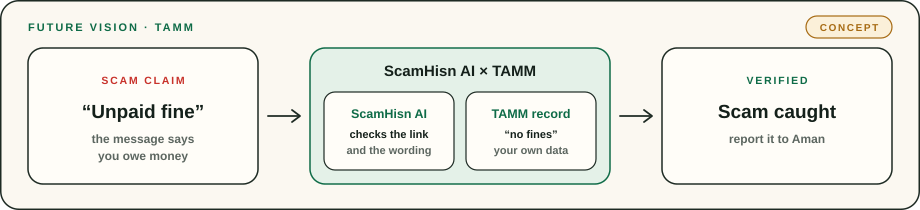
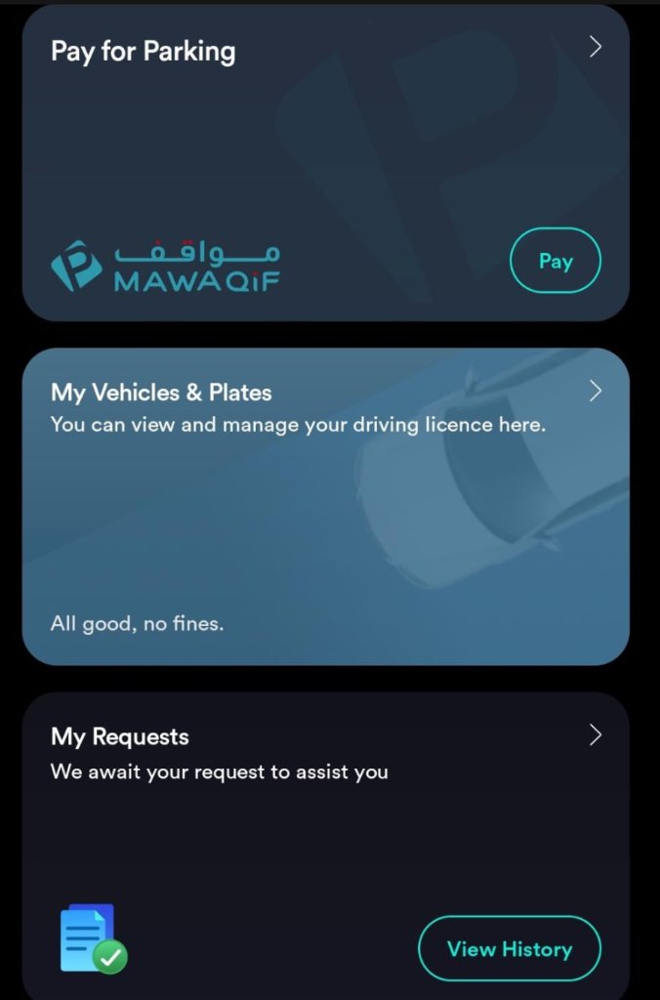
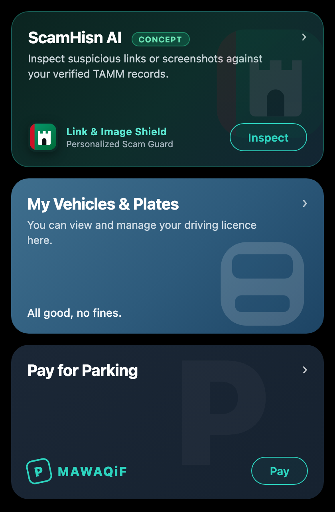

<strong>42 ABU DHABI × ABU DHABI POLICE — SCAMSHIELD AI HACKATHON</strong>

  

# ScamHisn AI · حصن الاحتيال

*AI-Powered Link, Image & Scam Inspector — Web App & Chrome Extension*

 

 

 

  

**[English (EN)](#en)** &nbsp;·&nbsp; **[العربية (AR)](#ar)**

 

 

## EN — Overview

**ScamHisn AI** is both a **Web Application** and a **Chrome Extension** that detects fraudulent links and forged/scam screenshots before users fall for them.

It supports **passive checking** (manual link & image inspection on demand) and **proactive checking** (automatic scanning of links on open web pages).

> [!TIP]
> **Latest Update — Screenshot & Image Authenticity Check (`NEW`):** Upload or paste any suspicious SMS, WhatsApp, email, or receipt screenshot to preview it live and verify whether it is **Genuine**, **Suspicious**, or **Scam / Forged**. Images are auto-compressed client-side (`≤768px` single vision tile) and cached via SHA-256 (**0 tokens** on repeat scans) to protect live API limits.

> [!IMPORTANT]
> **Why only the passive version is deployed live:** Both versions are built (`Chrome Extension/deployable/` and `Chrome Extension/dev/`), but proactive scanning is locked to *"Developers only"* in production. Running unauthenticated background AI scans publicly could lead to runaway API bills.

> [!NOTE]
> **Live Demo Rate Limits (`https://scamhisn-ai.onrender.com/`):** **15 req/min · 500 req/day · 50k tokens/min.**
> Normal testing will run smoothly unless many users test at the exact same moment—please test thoughtfully. *(Free-tier cold start takes ~30–50s if idle.)*

---

### The Problem & Our Solution

Residents face realistic scams impersonating **UAE PASS**, **TAMM**, **Abu Dhabi Police**, local banks, fake job offers, and hijacked **Google Maps** numbers.

**ScamHisn AI** opens suspicious links inside an isolated sandbox and delivers a decisive **0–100% scam score**—hitting **95–100%** immediately on fatal red flags instead of diluting them.

| Feature | What It Delivers |
|---|---|
| **4 Inspection Modes** | **General Link** (phishing & UAE brand spoofing) · **Job Post** (fake employers & visa fees) · **Map Link** (hijacked contacts & review attacks) · **Image Check (`NEW`)** (screenshot genuineness, tampering & visual scam detection). |
| **Live Image Preview & Low-Token AI** | Preview uploaded images right inside the app, spot forged receipts or smishing screenshots, extract hidden URLs for 1-click deep scanning, and save quota via `768px` compression + SHA-256 caching. |
| **Simple + Deep Views** | Clean percentage verdict for everyday users; **"Show Details"** reveals SSL, RDAP/WHOIS age, IPs, redirects, hidden DOM, authenticity analysis, and raw JSON for investigators. |
| **Police-Ready PDF** | One-click **"Generate Report"** exports a forensic A4 PDF (score, findings, WHOIS/TLS/IPs, UTC timestamp, raw JSON) for investigation or takedown. |
| **Police Reporting Concept** | Includes a conceptual **"Send to police for investigation"** button illustrating direct escalation to Abu Dhabi Police eCrime workflows. |

---

### How to Use It

<table>
<tr>
<td width="50%" valign="top">

**Web App (Phone & Laptop)**

1. Open **[scamhisn-ai.onrender.com](https://scamhisn-ai.onrender.com/)**.
2. Pick **General**, **Job**, **Map**, or **Image Check (`NEW`)** — paste a link or upload a screenshot with live preview.
3. Click **Inspect** → view score & genuineness verdict, **Show Details**, or **Generate Report (PDF)**.

*Phone Chrome tip:* Tap menu → **Add to Home screen** to install it like an app.

</td>
<td width="50%" valign="top">

**Chrome Extension (Desktop Browsers Only)**

1. **[Download Chrome Extension (.zip)](https://scamhisn-ai.onrender.com/scamhisn-extension.zip)** *(also linked at the very bottom of the web app)* and unzip it.
2. Open `chrome://extensions` → enable **Developer mode** → click **Load unpacked**.
3. Click the toolbar icon or right-click any link → **Inspect link with ScamHisn AI**.

</td>
</tr>
</table>

---

### How It Works

Every scan combines **Deterministic Checks** *(SSL certificates, SSRF safety guard, domain age/WHOIS, DNS/SPF/DMARC, security headers, and isolated browser rendering)* with **Semantic AI Checks** *(suspicious similarities, scam red flags, visual image forgery, and prompt-injection defense)*.

#### 1. Live Website (Links & Images)

  

#### 2. Chrome Extension (Desktop Browsers)

  

| Layer | Purpose |
|---|---|
| **Deterministic Checks** | **SSRF Guard**, **Playwright Sandbox**, **Node `tls`**, **RDAP/WHOIS**, **DNS (SPF/DMARC)** & **Security Headers** catch unsafe certificates, disposable new domains, redirects, and hidden forms. |
| **Semantic AI (`gemini-3.5-flash-lite`)** | Analyzes suspicious similarities, UAE brand spoofing, fake job/map claims, and **uploaded screenshots/images** (`≤768px` single tile + SHA-256 zero-token cache) while avoiding false positives on legitimate similar-named entities (e.g. ADIB vs. DIB). |
| **Anti-Prompt-Injection Shield** | Detects hidden AI-override attacks in HTML, comments, Maps reviews, and images, isolating untrusted text in cryptographic boundaries. |
| **Shared REST API (`/api/v1/scan` & `/scan-image`)** | Single backend powering the web app, image authenticity checker, PDF generator, and Chrome extension. |

---

### Future Vision: TAMM Ecosystem Integration

Integrating **ScamHisn AI** into Abu Dhabi's **TAMM** ecosystem unlocks proactive, resident-specific protection right inside the services residents already trust.

  

<table align="center">
<tr>
<td align="center" width="50%">
<strong>Current TAMM Experience</strong>  

</td>
<td align="center" width="50%">
<strong>Concept: TAMM with ScamHisn AI</strong>  

</td>
</tr>
</table>

- **Personalized Fact-Checking:** Cross-check scam claims against a resident's real TAMM records—instantly catching fake *"unpaid traffic fine"* or *"expired ID"* messages when their account shows *"All good, no fines."*
- **Native TAMM App Service:** Embed one-tap link and screenshot verification inside **TAMM** with authenticated reporting to **Abu Dhabi Police** cybercrime units.

> [!NOTE]
> **Architecture Scope:** The exact integration design and which specific TAMM tools, APIs, or data boundaries ScamHisn AI connects to are intentionally left for **TAMM experts and system architects** to design.

---

### Hosting & Deployment (Not Required — Already Live!)

**You do not need to host or deploy anything yourself** — we already deployed the live application for you at **[scamhisn-ai.onrender.com](https://scamhisn-ai.onrender.com/)**.

However, if you want to deploy your own copy for free on **Render**:

1. Push `Deployable Website Application/` to GitHub.
2. Create a **Blueprint** (or Docker Web Service) on Render connected to that repo.
3. Add `GEMINI_API_KEY` (see `.env.example`) in Render's Environment Variables and deploy.

---

### Team Cybersound

`Mohammed Ahmed Abdulnoor` · `Abdulrhman Ahmed Drizi` · `Khalid Ahmed Al Khawaldah` · `Ahmed Al Hashmi` · `Yousef Mohammed`

 

  

 

## AR — نظرة عامة

**حصن الاحتيال (ScamHisn AI)** هو **تطبيق ويب** و**إضافة لمتصفح كروم** تعتمد على الذكاء الاصطناعي لاكتشاف الروابط الاحتيالية وفحص الصور ولقطات الشاشة المشبوهة قبل الوقوع في فخ الاحتيال.

يدعم النظام **الفحص اليدوي (السلبي)** للروابط والصور عند الطلب، و**الفحص الاستباقي (النشط)** لمراقبة الروابط تلقائياً في صفحات الويب المفتوحة.

> **تحديث جديد — فحص الصور ولقطات الشاشة والتحقق من مصداقيتها:**
>
> يمكنك الآن رفع أو لصق أي لقطة شاشة مشبوهة (رسائل نصية، واتساب، بريد إلكتروني، أو إيصالات) مع معاينة فورية للصورة المرفوعة، للتحقق مما إذا كانت **أصلية وسليمة** أم **مشبوهة** أم **احتيال أو مزوّرة**. يتم ضغط الصور تلقائياً على جهاز المستخدم (`≤768px`) وتخزين نتائجها مؤقتاً ببصمة SHA-256 (**0 توكن** عند التكرار) للحفاظ على حدود استخدام مفتاح واجهة البرمجة.

 

> **تنويه مهم — لماذا نُشرت النسخة اليدوية فقط؟**
>
> تم تطوير النسختين معاً (النسخة الرسمية ونسخة المطورين)، غير أن وضع الفحص الاستباقي مقفل بعبارة **«للمطورين فقط»** في النسخة الرسمية، لأن تشغيل الفحص التلقائي للعامة دون مصادقة قد يؤدي إلى استهلاك مرتفع لمفتاح واجهة البرمجة وتكاليف غير متوقعة.

 

> **حدود الاستخدام للنسخة المباشرة (`scamhisn-ai.onrender.com`):**
>
> **15 طلباً/دقيقة · 500 طلب/يوم · 50 ألف رمز/دقيقة.**
>
> هذه الحدود كافية تماماً للتجربة الاعتيادية ما لم يختبر عدد كبير من المستخدمين الموقع في اللحظة نفسها، لذا يُرجى الاستخدام باعتدال. *(قد يستغرق تشغيل الخادم المجاني على Render نحو 30–50 ثانية بعد فترة خمول).*

---

### المشكلة والحل

يواجه المستخدمون يومياً روابط احتيال متقنة تنتحل **الهوية الرقمية (UAE PASS)**، و**منظومة تم (TAMM)**، و**شرطة أبوظبي**، والبنوك المحلية، وإعلانات التوظيف الوهمية، وأرقام التواصل المخترقة على **خرائط جوجل**.

يقوم **حصن الاحتيال** بفتح الرابط داخل بيئة معزولة تماماً، ويقدم **نسبة احتمال احتيال حاسمة (0–100%)** تصل فوراً إلى **95–100%** عند رصد أدلة قاطعة دون تمييعها بالمتوسطات.

| الميزة | الفائدة العملية |
|---|---|
| **4 أوضاع للفحص** | **رابط عام** (التصيّد وانتحال الجهات الإماراتية) · **إعلان وظيفة** (كشف الشركات الوهمية) · **رابط خريطة** (الأرقام المخترقة وهجمات التقييمات) · **فحص صورة (جديد)** (التحقق من أصالة الصور وكشف التزوير والاحتيال البصري). |
| **معاينة فورية واستهلاك اقتصادي للرموز** | عرض واضح للصورة المرفوعة قبل الفحص وداخل بطاقة النتيجة، مع استخراج الروابط المرصودة لفحصها بضغطة زر، وضغط تلقائي `768px` وتخزين مؤقت SHA-256 لحماية الرصيد. |
| **عرض بسيط ومفصّل** | ملخص واضح وسريع للمستخدم العادي، مع زر **"عرض التفاصيل التقنية"** للمحقق الرقمي (شهادة SSL، عمر النطاق WHOIS/RDAP، عناوين IP، التحويلات، تحليل الأصالة، وJSON). |
| **تقرير PDF جاهز للشرطة** | زر **"إنشاء تقرير (PDF)"** يصدر ملف أدلة جنائية منظماً (نسبة الخطر، الملاحظات، بيانات WHOIS/SSL/IP، التوقيت، وJSON الكامل) جاهزاً للتحقيق أو طلبات الإزالة. |
| **مفهوم الإبلاغ للشرطة** | يتضمن زر **"إرسال للشرطة للتحقيق"** كنموذج أولي يوضح مسار الربط المباشر المستقبلي مع فرق مكافحة الجرائم الإلكترونية. |

---

### طريقة الاستخدام

<table>
<tr>
<td width="50%" valign="top">

**تطبيق الويب (الهاتف والحاسوب)**

1. افتح **[scamhisn-ai.onrender.com](https://scamhisn-ai.onrender.com/)**.
2. اختر **رابط عام** أو **إعلان وظيفة** أو **رابط خريطة** أو **فحص صورة (جديد)** — الصق رابطاً أو ارفع صورة مع معاينة فورية.
3. اضغط **افحص** لعرض النتيجة وتقييم الأصالة أو **عرض التفاصيل** أو **إنشاء تقرير (PDF)**.

*لمستخدمي كروم على الهاتف:* من القائمة اختر **إضافة إلى الشاشة الرئيسية** لاستخدامه كتطبيق.

</td>
<td width="50%" valign="top">

**إضافة كروم (لمتصفحات الحاسوب فقط)**

1. **[تحميل إضافة كروم (.zip)](https://scamhisn-ai.onrender.com/scamhisn-extension.zip)** *(كما يتوفر رابط التحميل في نهاية صفحة تطبيق الويب)* ثم فك الضغط عن الملف.
2. افتح `chrome://extensions` ← فعّل **وضع مطوّر البرامج** ← اضغط **Load unpacked** واختر المجلد.
3. اضغط أيقونة الإضافة أو انقر بزر الفأرة الأيمن على أي رابط لفحصه فوراً.

</td>
</tr>
</table>

---

### آلية العمل

يجمع كل فحص بين **الفحوصات الحتمية (Deterministic)** *(شهادات SSL، درع SSRF، عمر النطاق WHOIS/RDAP، سجلات DNS/SPF/DMARC، ترويسات الأمان، والبيئة المعزولة)* وبين **الفحص الدلالي بالذكاء الاصطناعي (Semantic)** *(التشابه المشبوه، علامات الاحتيال، كشف تزوير الصور، وصد حقن الأوامر)*.

#### 1. تطبيق الويب المباشر (الروابط والصور)

  

#### 2. إضافة متصفح كروم (للحاسوب)

  

| الطبقة | الدور داخل النظام |
|---|---|
| **الفحوصات الحتمية (Deterministic)** | **درع SSRF** و**متصفح Playwright المعزول** و**شهادات SSL** و**عمر النطاق RDAP/WHOIS** و**سجلات DNS/SPF/DMARC** لرصد النطاقات المؤقتة والتحويلات والنماذج المخفية. |
| **الفحص الدلالي (`gemini-3.5-flash-lite`)** | يحلل التشابه المشبوه وانتحال الجهات الإماراتية وإعلانات الوظائف والخرائط، ويفحص **الصور ولقطات الشاشة المرفوعة** (`≤768px` مع تخزين مؤقت SHA-256 بصفر رموز عند التكرار) دون التباس بين الجهات الشرعية متشابهة الأسماء (مثل ADIB وDIB). |
| **درع صد حقن الأوامر** | يرصد أوامر التلاعب المخفية في الصفحات وتقييمات الخرائط والصور، ويعزل النصوص غير الموثوقة بحدود مشفرة. |
| **واجهة برمجية موحدة (`/api/v1/scan` و `/scan-image`)** | خادم واحد يغذي تطبيق الويب وفاحص الصور ومولّد تقارير PDF وإضافة المتصفح بسهولة وقابلية للتوسع. |

---

### الرؤية المستقبلية: التكامل مع منظومة «تم» (TAMM)

يتيح دمج **حصن الاحتيال** ضمن بيئة **منظومة «تم» (TAMM)** حماية استباقية مخصّصة للمستخدم داخل الخدمات الحكومية التي يثق بها يومياً.

  

<table align="center">
<tr>
<td align="center" width="50%">
<strong>تطبيق «تم» الحالي</strong>  

</td>
<td align="center" width="50%">
<strong>تصوّر مستقبلي: «تم» مع حصن الاحتيال</strong>  

</td>
</tr>
</table>

- **كشف مخصّص للاحتيال عبر بيانات المستخدم:** التحقق الفوري من صحة ادعاءات الرسائل المشبوهة (مثل *"مخالفة مرورية غير مدفوعة"*) مقارنةً بوضع المستفيد الفعلي في «تم» (مثل ظهور *"لا توجد مخالفات"* في سجل المركبات).
- **خدمة مدمجة داخل تطبيق «تم»:** توفير فحص الروابط والصور بضغطة واحدة داخل التطبيق مع إمكانية رفع البلاغات الموثّقة مباشرةً إلى **شرطة أبوظبي**.

> **نطاق التصميم المعماري:**
>
> تُترك تفاصيل آلية التكامل التقني والأدوات أو الخدمات المحددة التي يتصل بها «حصن الاحتيال» داخل منظومة «تم» **للخبراء ومهندسي الأنظمة المختصين** لتصميمها وفق أعلى معايير الأمان والخصوصية.

---

### الاستضافة والنشر (غير مطلوب — التطبيق منشور وجاهز!)

**لا حاجة لاستضافة التطبيق أو نشره بنفسك**؛ فقد قمنا بنشر النسخة المباشرة وجعلها جاهزة للاستخدام الفوري عبر **[scamhisn-ai.onrender.com](https://scamhisn-ai.onrender.com/)**.

ومع ذلك، إذا رغبت في نشر نسختك الخاصة مجاناً على **Render**:

1. ارفع مجلد `Deployable Website Application/` إلى مستودع GitHub.
2. أنشئ **Blueprint** (أو Docker Web Service) على Render واربطه بالمستودع.
3. أضف `GEMINI_API_KEY` (انظر `.env.example`) في متغيرات البيئة ثم ابدأ النشر.

---

### فريق العمل — Team Cybersound

`Mohammed Ahmed Abdulnoor` · `Abdulrhman Ahmed Drizi` · `Khalid Ahmed Al Khawaldah` · `Ahmed Al Hashmi` · `Yousef Mohammed`

