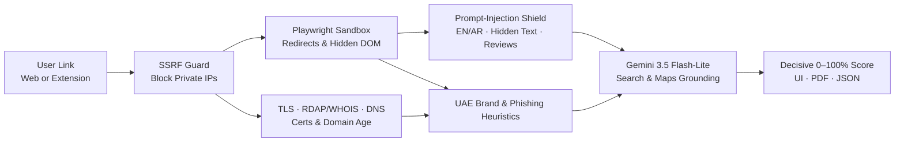

<strong>42 ABU DHABI × ABU DHABI POLICE — SCAMSHIELD AI HACKATHON</strong>

  

# ScamHisn AI · حصن الاحتيال

*AI-Powered Scam & Link Inspector — Web App & Chrome Extension*

 

 

  

**[English (EN)](#en)** &nbsp;·&nbsp; **[العربية (AR)](#ar)**

 

 

## EN — Overview

**ScamHisn AI** is both a **Web Application** and a **Chrome Extension** that detects fraudulent links before users click them.

It supports **passive checking** (manual inspection on demand) and **proactive checking** (automatic scanning of links on open web pages).

> [!IMPORTANT]
> **Why only the passive version is deployed live:** Both versions are built (`Chrome Extension/deployable/` and `Chrome Extension/dev/`), but proactive scanning is locked to *"Developers only"* in production. Running unauthenticated background AI scans publicly could lead to runaway API bills.

> [!NOTE]
> **Live Demo Rate Limits (`https://scamhisn-ai.onrender.com/`):** **15 req/min · 500 req/day · 50k tokens/min.**
> Normal testing will run smoothly unless many users test at the exact same moment—please test thoughtfully. *(Free-tier cold start takes ~30–50s if idle.)*

---

### The Problem & Our Solution

Residents face realistic scams impersonating **UAE PASS**, **TAMM**, **Abu Dhabi Police**, local banks, fake job offers, and hijacked **Google Maps** numbers.

**ScamHisn AI** opens suspicious links inside an isolated sandbox and delivers a decisive **0–100% scam score**—hitting **95–100%** immediately on fatal red flags instead of diluting them.

| Feature | What It Delivers |
|---|---|
| **3 Inspection Modes** | **General Link** (phishing & UAE brand spoofing) · **Job Post** (fake employers & visa fees) · **Map Link** (hijacked contacts & review attacks). |
| **Simple + Deep Views** | Clean percentage verdict for everyday users; **"Show Details"** reveals SSL, RDAP/WHOIS age, IPs, redirects, hidden DOM, and raw JSON for investigators. |
| **Police-Ready PDF** | One-click **"Generate Report"** exports a forensic A4 PDF (score, findings, WHOIS/TLS/IPs, UTC timestamp, raw JSON) for investigation or takedown. |
| **Police Reporting Concept** | Includes a conceptual **"Send to police for investigation"** button illustrating direct escalation to Abu Dhabi Police eCrime workflows. |

---

### How to Use It

<table>
<tr>
<td width="50%" valign="top">

**Web App (Phone & Laptop)**

1. Open **[scamhisn-ai.onrender.com](https://scamhisn-ai.onrender.com/)**.
2. Pick **General**, **Job**, or **Map** and paste any link.
3. Click **Inspect Link** → view score, **Show Details**, or **Generate Report (PDF)**.

*Phone Chrome tip:* Tap menu → **Add to Home screen** to install it like an app.

</td>
<td width="50%" valign="top">

**Chrome Extension (Desktop)**

1. Download the `.zip` from the bottom of the website (or `Chrome Extension/scamhisn-extension-prod.zip`) and unzip it.
2. Open `chrome://extensions` → enable **Developer mode** → click **Load unpacked**.
3. Click the toolbar icon or right-click any link → **Inspect link with ScamHisn AI**.

</td>
</tr>
</table>

---

### How It Works

| Layer | Purpose |
|---|---|
| **Playwright Headless Shell** | Opens links safely in a throwaway sandbox (no downloads/cookies), follows redirects, and catches hidden cloaking. |
| **Node `tls`, RDAP/WHOIS & DNS** | Verifies SSL certificates, flags newly registered domains (`<30d`), and checks SPF/DMARC records. |
| **UAE Brand & Anomaly Guard** | Catches lookalike domains and impersonation of UAE portals (**TAMM**, **UAE PASS**, local banks) while keeping false positives low. |
| **Anti-Prompt-Injection Shield** | Detects hidden AI-override attacks in HTML, comments, and Maps reviews, isolating untrusted text in cryptographic boundaries. |
| **Gemini (`gemini-3.5-flash-lite`)** | Verifies real-world claims with Search/Maps grounding and outputs bilingual structured forensic findings. |
| **Shared REST API (`/api/v1/scan`)** | Single backend powering the web app, PDF generator, and Chrome extension. |

---

### Future Vision: TAMM Ecosystem Integration

Integrating **ScamHisn AI** into Abu Dhabi's **TAMM** ecosystem unlocks proactive, resident-specific protection:

- **Personalized Fact-Checking:** Cross-check scam claims against a resident's real TAMM records—instantly catching fake *"unpaid traffic fine"* or *"expired ID"* messages when the user has none.
- **Native TAMM App Service:** Embed one-tap link verification inside the **TAMM** app with authenticated, direct reporting to **Abu Dhabi Police** cybercrime units.

---

### Host Your Own Copy (Optional)

Deployment takes a few minutes, so we already hosted it live at **[scamhisn-ai.onrender.com](https://scamhisn-ai.onrender.com/)**. To self-host for free on **Render**:

1. Push `Deployable Website Application/` to GitHub.
2. Create a **Blueprint** (or Docker Web Service) on Render connected to that repo.
3. Add `GEMINI_API_KEY` (see `.env.example`) in Render's Environment Variables and deploy.

---

### Team Cybersound

`Mohammed Ahmed Abdulnoor` · `Abdulrhman Ahmed Drizi` · `Khalid Ahmed Al Khawaldah` · `Ahmed Al Hashmi` · `Yousef Mohammed`

 

  

 

## AR — نظرة عامة

**حصن الاحتيال (ScamHisn AI)** هو **تطبيق ويب** و**إضافة لمتصفح كروم** تعتمد على الذكاء الاصطناعي لاكتشاف الروابط الاحتيالية قبل النقر عليها.

يدعم النظام **الفحص اليدوي (السلبي)** عند الطلب، و**الفحص الاستباقي (النشط)** لمراقبة الروابط تلقائياً في صفحات الويب المفتوحة.

> [!IMPORTANT]
> **لماذا نُشرت النسخة اليدوية فقط؟** تم تطوير النسختين معاً (`Chrome Extension/deployable/` و`Chrome Extension/dev/`)، غير أن وضع الفحص الاستباقي مقفل بعبارة **"للمطورين فقط"** في النسخة الرسمية، لأن تشغيل الفحص التلقائي للعامة دون مصادقة قد يؤدي إلى استهلاك مرتفع لمفتاح واجهة البرمجة وتكاليف غير متوقعة.

> [!NOTE]
> **حدود الاستخدام للنسخة المباشرة (`https://scamhisn-ai.onrender.com/`):** **15 طلباً/دقيقة · 500 طلب/يوم · 50 ألف رمز/دقيقة.**
> هذه الحدود كافية تماماً للتجربة الاعتيادية ما لم يختبر عدد كبير من المستخدمين الموقع في اللحظة نفسها، لذا يُرجى الاستخدام باعتدال. *(قد يستغرق تشغيل الخادم المجاني على Render نحو 30–50 ثانية بعد فترة خمول).*

---

### المشكلة والحل

يواجه المستخدمون يومياً روابط احتيال متقنة تنتحل **الهوية الرقمية (UAE PASS)**، و**منظومة تم (TAMM)**، و**شرطة أبوظبي**، والبنوك المحلية، وإعلانات التوظيف الوهمية، وأرقام التواصل المخترقة على **خرائط جوجل**.

يقوم **حصن الاحتيال** بفتح الرابط داخل بيئة معزولة تماماً، ويقدم **نسبة احتمال احتيال حاسمة (0–100%)** تصل فوراً إلى **95–100%** عند رصد أدلة قاطعة دون تمييعها بالمتوسطات.

| الميزة | الفائدة العملية |
|---|---|
| **3 أوضاع للفحص** | **رابط عام** (التصيّد وانتحال الجهات الإماراتية) · **إعلان وظيفة** (كشف الشركات الوهمية) · **رابط خريطة** (الأرقام المخترقة وهجمات التقييمات). |
| **عرض بسيط ومفصّل** | ملخص واضح وسريع للمستخدم العادي، مع زر **"عرض التفاصيل التقنية"** للمحقق الرقمي (شهادة SSL، عمر النطاق WHOIS/RDAP، عناوين IP، التحويلات، وJSON). |
| **تقرير PDF جاهز للشرطة** | زر **"إنشاء تقرير (PDF)"** يصدر ملف أدلة جنائية منظماً (نسبة الخطر، الملاحظات، بيانات WHOIS/SSL/IP، التوقيت، وJSON الكامل) جاهزاً للتحقيق أو طلبات الإزالة. |
| **مفهوم الإبلاغ للشرطة** | يتضمن زر **"إرسال للشرطة للتحقيق"** كنموذج أولي يوضح مسار الربط المباشر المستقبلي مع فرق مكافحة الجرائم الإلكترونية. |

---

### طريقة الاستخدام

<table>
<tr>
<td width="50%" valign="top">

**تطبيق الويب (الهاتف والحاسوب)**

1. افتح **[scamhisn-ai.onrender.com](https://scamhisn-ai.onrender.com/)**.
2. اختر **رابط عام** أو **إعلان وظيفة** أو **رابط خريطة** ثم الصق الرابط.
3. اضغط **افحص الرابط** لعرض النتيجة أو **عرض التفاصيل** أو **إنشاء تقرير (PDF)**.

*لمستخدمي كروم على الهاتف:* من القائمة اختر **إضافة إلى الشاشة الرئيسية** لاستخدامه كتطبيق.

</td>
<td width="50%" valign="top">

**إضافة كروم (الحاسوب)**

1. حمّل ملف `.zip` من أسفل الموقع (أو من `Chrome Extension/scamhisn-extension-prod.zip`) وفك الضغط عنه.
2. افتح `chrome://extensions` ← فعّل **وضع مطوّر البرامج** ← اضغط **Load unpacked** واختر المجلد.
3. اضغط أيقونة الإضافة أو انقر بزر الفأرة الأيمن على أي رابط لفحصه فوراً.

</td>
</tr>
</table>

---

### آلية العمل التقنية

| التقنية | الدور داخل النظام |
|---|---|
| **Playwright (متصفح معزول)** | يفتح الروابط في بيئة مؤقتة آمنة (دون تنزيلات أو ملفات ارتباط)، ويتتبع التحويلات ويكشف العناصر المخفية. |
| **Node `tls` و RDAP/WHOIS و DNS** | يفحص شهادات الأمان، ويرصد النطاقات المسجلة حديثاً (أقل من 30 يوماً)، ويتحقق من سجلات SPF/DMARC. |
| **حماية العلامات الإماراتية** | يكشف النطاقات المقلّدة وانتحال الجهات المحلية (**تم**، **الهوية الرقمية**، البنوك) مع تقليل الإنذارات الكاذبة. |
| **درع صد حقن الأوامر** | يرصد أوامر التلاعب المخفية في الصفحات وتقييمات الخرائط ويعزل النصوص غير الموثوقة بحدود مشفرة. |
| **Gemini (`gemini-3.5-flash-lite`)** | يتحقق من الادعاءات والشركات والأماكن عبر البحث والخرائط، ويولّد تحليلاً منظماً ثنائي اللغة. |
| **واجهة برمجية موحدة (`/api/v1/scan`)** | خادم واحد يغذي تطبيق الويب ومولّد تقارير PDF وإضافة المتصفح بسهولة وقابلية للتوسع. |

---

### الرؤية المستقبلية: التكامل مع منظومة «تم» (TAMM)

يتيح دمج **حصن الاحتيال** ضمن بيئة **منظومة «تم» (TAMM)** نقلة نوعية في حماية المجتمع:

- **كشف مخصّص للاحتيال عبر بيانات المستخدم:** التحقق الفوري من صحة ادعاءات الرسائل المشبوهة (مثل *"مخالفة مرورية غير مدفوعة"* أو *"انتهاء الهوية"*) مقارنةً بوضع المستفيد الفعلي في «تم»، مما يكشف المعلومات المغلوطة فوراً.
- **خدمة مدمجة داخل تطبيق «تم»:** توفير أداة فحص الروابط مباشرةً داخل التطبيق مع إمكانية رفع البلاغات الموثقة مباشرةً إلى **شرطة أبوظبي**.

---

### الاستضافة الذاتية (اختياري)

نظراً لأن النشر يستغرق بضع دقائق، وفرنا النسخة الجاهزة على **[scamhisn-ai.onrender.com](https://scamhisn-ai.onrender.com/)**. ولنشر نسختك مجاناً عبر **Render**:

1. ارفع مجلد `Deployable Website Application/` إلى مستودع GitHub.
2. أنشئ **Blueprint** (أو Docker Web Service) على Render واربطه بالمستودع.
3. أضف `GEMINI_API_KEY` (انظر `.env.example`) في متغيرات البيئة ثم ابدأ النشر.

---

### فريق العمل — Team Cybersound

`Mohammed Ahmed Abdulnoor` · `Abdulrhman Ahmed Drizi` · `Khalid Ahmed Al Khawaldah` · `Ahmed Al Hashmi` · `Yousef Mohammed`

