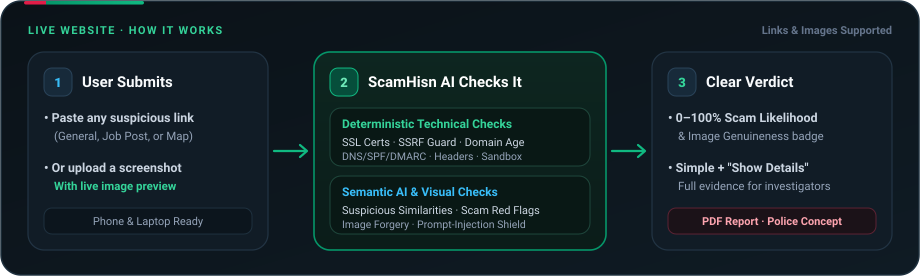
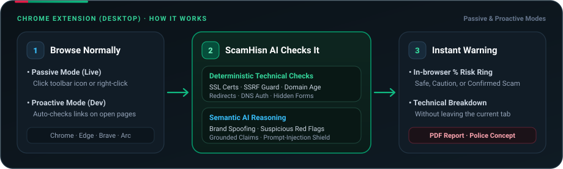

<strong>42 ABU DHABI × ABU DHABI POLICE — SCAMSHIELD AI HACKATHON</strong>

  

# ScamHisn AI · حصن الاحتيال

*AI-Powered Link, Image & Scam Inspector — Web App & Chrome Extension*

 

 

 

  

**[English (EN)](#en)** &nbsp;·&nbsp; **[العربية (AR)](#ar)**

 

 

## EN — Overview

**ScamHisn AI** is a **Web Application** and **Chrome Extension** that protects users from fraudulent links and forged screenshots—including scams impersonating **UAE PASS**, **TAMM**, **Abu Dhabi Police**, local banks, fake jobs, and hijacked **Google Maps** listings.

It supports **passive checking** (manual inspection on demand) and **proactive checking** (automatic link scanning on open web pages).

> [!IMPORTANT]
> **Why only the passive version is deployed live:** Both versions are built (`Chrome Extension/deployable/` and `Chrome Extension/dev/`), but proactive scanning is locked to *"Developers only"* in production to prevent runaway public API costs.

> [!NOTE]
> **Live Demo Rate Limits (`https://scamhisn-ai.onrender.com/`):** **15 req/min · 500 req/day · 50k tokens/min.**
> Normal testing runs smoothly unless many people test simultaneously—please test thoughtfully. *(Free-tier cold start takes ~30–50s if idle.)*

---

### What It Delivers

**Four Inspection Modes**
Check **General Links**, **Job Posts**, **Map Links**, or upload **Screenshots & Images** with a live preview to verify whether an image is genuine or forged.

**Decisive 0–100% Scam Score**
Fatal red flags immediately score **95–100%** instead of being diluted, while legitimate lookalike organizations (such as ADIB vs. DIB) are not falsely penalized.

**Simple View + Investigator Details**
Everyday users get a clear verdict at a glance; **"Show Details"** reveals technical findings for deeper investigation.

**Forensic PDF & Police Escalation Concept**
Export an investigation-ready **PDF report** in one click, alongside a conceptual **"Send to police for investigation"** button illustrating direct eCrime reporting.

---

### How to Use It

<table>
<tr>
<td width="50%" valign="top">

**Web App (Phone & Laptop)**

1. Open **[scamhisn-ai.onrender.com](https://scamhisn-ai.onrender.com/)**.
2. Choose **General**, **Job**, **Map**, or **Image Check**, then paste a link or upload an image.
3. Click **Inspect** to view the verdict, details, or download a PDF report.

*Phone Chrome tip:* Tap menu → **Add to Home screen** to use it like an app.

</td>
<td width="50%" valign="top">

**Chrome Extension (Desktop Browsers Only)**

1. **[Download Chrome Extension (.zip)](https://scamhisn-ai.onrender.com/scamhisn-extension.zip)** *(also linked at the very bottom of the web app)* and unzip it.
2. Open `chrome://extensions` → enable **Developer mode** → click **Load unpacked**.
3. Click the toolbar icon or right-click any link → **Inspect link with ScamHisn AI**.

</td>
</tr>
</table>

---

### How It Works

Every scan blends **Deterministic Checks** *(SSL certificates, domain age, safety guards, and isolated sandbox inspection)* with **Semantic AI Checks** *(suspicious similarities, scam red flags, visual forgery detection, and anti-prompt-injection defense)*.

#### 1. Live Website (Links & Images)

  

#### 2. Chrome Extension (Desktop Browsers)

  

---

### Future Vision: TAMM Ecosystem Integration

Bringing **ScamHisn AI** into Abu Dhabi's **TAMM** ecosystem unlocks personalized scam protection inside the services residents already trust.

  

<table align="center">
<tr>
<td align="center" width="50%">
<strong>Current TAMM Experience</strong>  

</td>
<td align="center" width="50%">
<strong>Concept: TAMM with ScamHisn AI</strong>  

</td>
</tr>
</table>

**Personalized Fact-Checking**
Cross-check scam messages against a resident's real TAMM records—instantly catching fake *"unpaid fine"* claims when their account shows *"All good, no fines."*

**Native TAMM App Service**
Embed one-tap link and screenshot verification directly inside **TAMM** with authenticated escalation to **Abu Dhabi Police**.

> [!NOTE]
> **Architecture Scope:** The exact integration design and which specific TAMM tools or services ScamHisn AI connects to are intentionally left for **TAMM experts and system architects** to design.

---

### Hosting & Deployment (Not Required — Already Live!)

**You do not need to host or deploy anything yourself** — the live app is already running at **[scamhisn-ai.onrender.com](https://scamhisn-ai.onrender.com/)**.

If you ever want to deploy your own free copy on **Render**:

1. Push `Deployable Website Application/` to GitHub.
2. Create a **Blueprint** (or Docker Web Service) on Render connected to that repo.
3. Add `GEMINI_API_KEY` (see `.env.example`) in Render's Environment Variables and deploy.

---

### Team Cybersound

`Mohammed Ahmed Abdulnoor` · `Abdulrhman Ahmed Drizi` · `Khalid Ahmed Al Khawaldah` · `Ahmed Al Hashmi` · `Yousef Mohammed`

 

  

 

## AR — نظرة عامة

**حصن الاحتيال (ScamHisn AI)** هو **تطبيق ويب** و**إضافة لمتصفح كروم** لحماية المستخدمين من الروابط الاحتيالية والصور المزوّرة، بما في ذلك عمليات الانتحال التي تستهدف **الهوية الرقمية (UAE PASS)** و**منظومة تم (TAMM)** و**شرطة أبوظبي** والبنوك المحلية وإعلانات التوظيف الوهمية و**خرائط جوجل**.

يدعم النظام **الفحص اليدوي (السلبي)** عند الطلب، و**الفحص الاستباقي (النشط)** لمراقبة الروابط تلقائياً في صفحات الويب المفتوحة.

> **تنويه مهم — لماذا نُشرت النسخة اليدوية فقط؟**
>
> تم تطوير النسختين معاً، غير أن وضع الفحص الاستباقي مقفل بعبارة **«للمطورين فقط»** في النسخة الرسمية، لأن تشغيل الفحص التلقائي للعامة دون مصادقة قد يؤدي إلى استهلاك مرتفع لمفتاح واجهة البرمجة وتكاليف غير متوقعة.

 

> **حدود الاستخدام للنسخة المباشرة (`scamhisn-ai.onrender.com`):**
>
> **15 طلباً/دقيقة · 500 طلب/يوم · 50 ألف رمز/دقيقة.**
>
> هذه الحدود كافية تماماً للتجربة الاعتيادية ما لم يختبر عدد كبير من المستخدمين الموقع في اللحظة نفسها، لذا يُرجى الاستخدام باعتدال. *(قد يستغرق تشغيل الخادم المجاني على Render نحو 30–50 ثانية بعد فترة خمول).*

---

### أبرز ما يقدمه التطبيق

**أربعة أوضاع للفحص**
افحص **الروابط العامة** أو **إعلانات الوظائف** أو **روابط الخرائط** أو ارفع **الصور ولقطات الشاشة** مع معاينة فورية للتحقق من أصالتها وكشف التزوير.

**نسبة احتمال احتيال حاسمة (0–100%)**
تصل النتيجة فوراً إلى **95–100%** عند وجود أدلة قاطعة دون تمييع، مع تجنّب الإنذارات الكاذبة للجهات الشرعية متشابهة الأسماء (مثل ADIB وDIB).

**عرض بسيط وتفاصيل للمحققين**
يظهر ملخص واضح وسريع للمستخدم العادي، مع زر **«عرض التفاصيل التقنية»** لعرض الأدلة المعمّقة عند الحاجة.

**تقرير PDF ومفهوم الإبلاغ للشرطة**
إمكانية تصدير **تقرير أدلة بصيغة PDF** بضغطة زر، إلى جانب زر تجريبي **«إرسال للشرطة للتحقيق»** يوضح مسار الربط المستقبلي.

---

### طريقة الاستخدام

<table>
<tr>
<td width="50%" valign="top">

**تطبيق الويب (الهاتف والحاسوب)**

1. افتح **[scamhisn-ai.onrender.com](https://scamhisn-ai.onrender.com/)**.
2. اختر **رابط عام** أو **إعلان وظيفة** أو **رابط خريطة** أو **فحص صورة**، ثم الصق الرابط أو ارفع الصورة.
3. اضغط **افحص** لعرض النتيجة أو التفاصيل أو تحميل تقرير PDF.

*لمستخدمي كروم على الهاتف:* من القائمة اختر **إضافة إلى الشاشة الرئيسية** لاستخدامه كتطبيق.

</td>
<td width="50%" valign="top">

**إضافة كروم (لمتصفحات الحاسوب فقط)**

1. **[تحميل إضافة كروم (.zip)](https://scamhisn-ai.onrender.com/scamhisn-extension.zip)** *(كما يتوفر رابط التحميل في نهاية صفحة تطبيق الويب)* ثم فك الضغط عن الملف.
2. افتح `chrome://extensions` ← فعّل **وضع مطوّر البرامج** ← اضغط **Load unpacked** واختر المجلد.
3. اضغط أيقونة الإضافة أو انقر بزر الفأرة الأيمن على أي رابط لفحصه فوراً.

</td>
</tr>
</table>

---

### آلية العمل

يجمع كل فحص بين **الفحوصات الحتمية** *(شهادات SSL، عمر النطاق، ضوابط الأمان، والبيئة المعزولة)* وبين **الفحص الدلالي بالذكاء الاصطناعي** *(التشابه المشبوه، علامات الاحتيال، كشف تزوير الصور، وصد حقن الأوامر)*.

#### 1. تطبيق الويب المباشر (الروابط والصور)

  

#### 2. إضافة متصفح كروم (للحاسوب)

  

---

### الرؤية المستقبلية: التكامل مع منظومة «تم» (TAMM)

يتيح دمج **حصن الاحتيال** ضمن **منظومة «تم» (TAMM)** حماية استباقية مخصّصة للمستخدم داخل الخدمات الحكومية التي يثق بها يومياً.

  

<table align="center">
<tr>
<td align="center" width="50%">
<strong>تطبيق «تم» الحالي</strong>  

</td>
<td align="center" width="50%">
<strong>تصوّر مستقبلي: «تم» مع حصن الاحتيال</strong>  

</td>
</tr>
</table>

**كشف مخصّص للاحتيال عبر بيانات المستخدم**
التحقق الفوري من ادعاءات الرسائل المشبوهة (مثل *"مخالفة مرورية غير مدفوعة"*) مقارنةً بحالة المستفيد الفعلية في «تم» (مثل ظهور *"لا توجد مخالفات"*).

**خدمة مدمجة داخل تطبيق «تم»**
توفير فحص الروابط والصور بضغطة واحدة داخل التطبيق مع إمكانية رفع البلاغات الموثّقة مباشرةً إلى **شرطة أبوظبي**.

> **نطاق التصميم المعماري:**
>
> تُترك تفاصيل آلية التكامل التقني والأدوات أو الخدمات المحددة التي يتصل بها «حصن الاحتيال» داخل منظومة «تم» **للخبراء ومهندسي الأنظمة المختصين** لتصميمها وفق أعلى معايير الأمان والخصوصية.

---

### الاستضافة والنشر (غير مطلوب — التطبيق منشور وجاهز!)

**لا حاجة لاستضافة التطبيق أو نشره بنفسك**؛ فالنسخة المباشرة جاهزة للاستخدام الفوري عبر **[scamhisn-ai.onrender.com](https://scamhisn-ai.onrender.com/)**.

ومع ذلك، إذا رغبت في نشر نسختك الخاصة مجاناً على **Render**:

1. ارفع مجلد `Deployable Website Application/` إلى مستودع GitHub.
2. أنشئ **Blueprint** (أو Docker Web Service) على Render واربطه بالمستودع.
3. أضف `GEMINI_API_KEY` (انظر `.env.example`) في متغيرات البيئة ثم ابدأ النشر.

---

### فريق العمل — Team Cybersound

`Mohammed Ahmed Abdulnoor` · `Abdulrhman Ahmed Drizi` · `Khalid Ahmed Al Khawaldah` · `Ahmed Al Hashmi` · `Yousef Mohammed`

